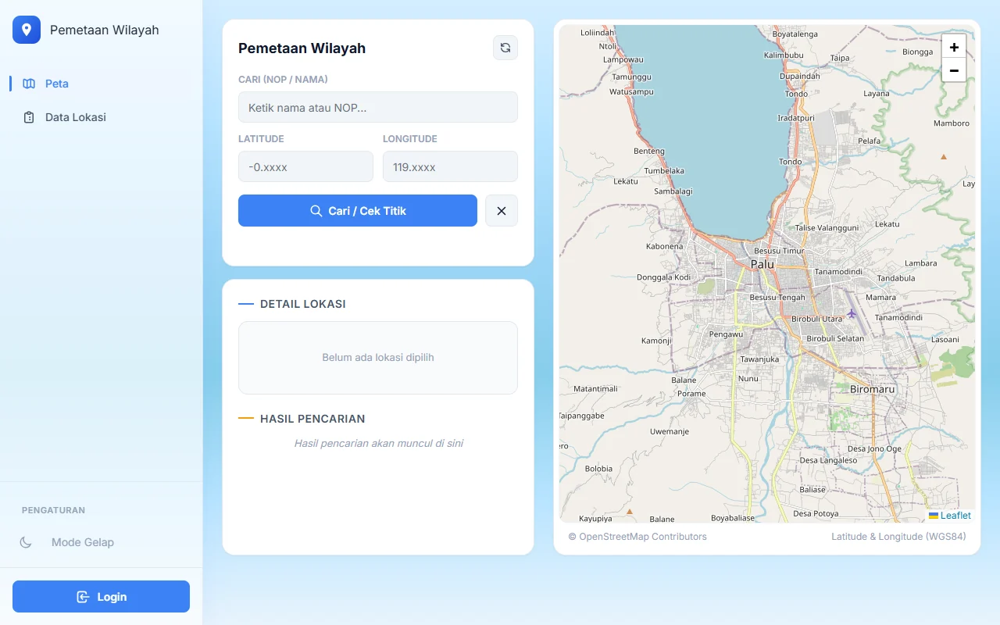

# Pemwil Palu — Web GIS Pemetaan Wilayah

Sistem Informasi Geografis (SIG) batas administratif dan titik lokasi **Kota Palu** dengan peta interaktif Leaflet, rendering multi-layer GeoJSON, deteksi duplikasi koordinat, dan audit perubahan.

[](https://pemwilpalu.gimmhost.my.id/)




### Fitur & Teknologi

| Modul | Detail | Paket / Tech |
| :--- | :--- | :--- |
| **Interactive Map** | `/map` & mode gelap, cek titik koordinat/NOP & layer batas | `Leaflet.js`, `GeoJSON`, `Alpine.js` |
| **Data Explorer** | Tabel lokasi reaktif, filter pencarian & akses publik read-only | `Livewire / Volt`, `Tailwind CSS` |
| **Import & Laporan** | Impor Excel massal (`/import`) & ekspor laporan PDF siap cetak | `maatwebsite/excel`, `dompdf` |
| **Keamanan & Audit** | Manajemen role/user (`/users`, `/roles`) + histori aktivitas | `spatie/laravel-activitylog` |

### Quick Start

```bash
composer install && npm install
cp .env.example .env && php artisan key:generate
php artisan migrate --seed && npm run build && php artisan serve
```
